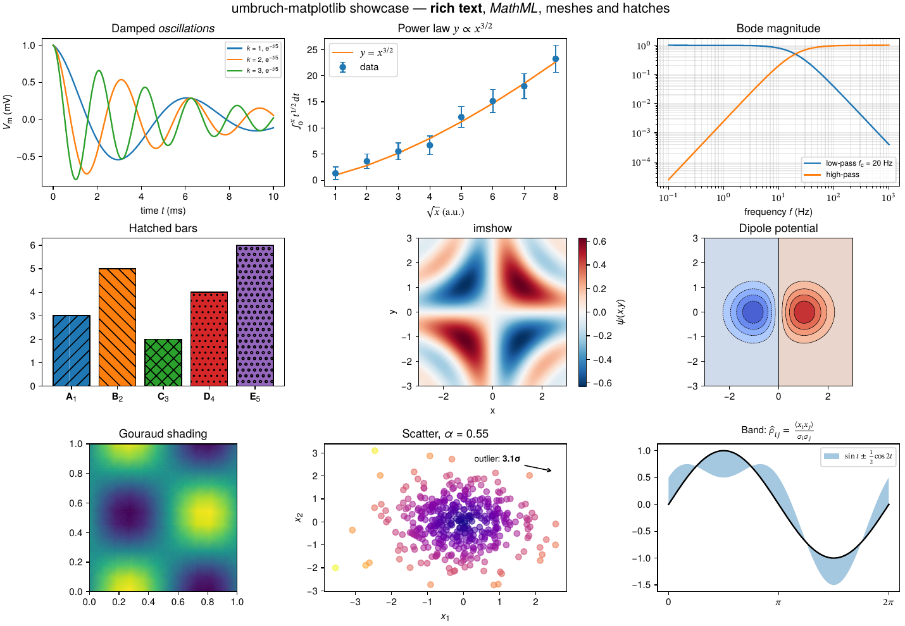

# umbruch-matplotlib

*Umbruch* (OOM-brookh) is German for page makeup, and also for upheaval.

A Matplotlib backend that draws figures as SVG and renders them to PDF with
[umbruch](https://github.com/manuel-rhdt/umbruch). Text and math are laid out by umbruch:
labels may contain rich text (`rich("<i>t</i><sub>0</sub>")`) and `$...$` math is converted to
MathML. It talks to umbruch through the `umbruch` package (`umbruch.Server`, version 0.5.2 or later); the executable comes with the package, and `$UMBRUCH` or `PATH` override it.

```python
import matplotlib
matplotlib.use("module://umbruch_matplotlib")
import matplotlib.pyplot as plt
from umbruch_matplotlib import rich

fig, ax = plt.subplots()
ax.set_xlabel(rich("time <i>t</i> (ms)"))
ax.set_title(r"$\hat\rho_{ij}=\frac{a}{b}$")
fig.savefig("fig.pdf")
```

Install with `pip install .[math]` (the `math` extra pulls in `latex2mathml`).

The backend builds on parts of Matplotlib's SVG renderer that are not public API. It is tested with Matplotlib 3.9, 3.10 and 3.11 (CI runs the oldest and the newest), and on import it checks that the parts it needs are there, naming what is missing otherwise.

Unsupported features raise instead of falling back to Matplotlib's own text rendering:
`text.usetex`, and TeX that cannot be converted to MathML.

Fonts come from Matplotlib: for every text, the font file that `font_manager.findfont` picks (including fonts added with `fontManager.addfont`) is sent to umbruch as an `@font-face` with a `data:` URI, so the PDF uses the face Matplotlib measured, with real italic and bold faces, and nothing depends on umbruch seeing the system's fonts. The families of the text follow as CSS fallbacks. Measuring sends each face once, as the style sheet that umbruch remembers (`Server.set_stylesheet`, umbruch 0.5.3 or later; an older umbruch gets the rules with each request, which can measure later probes of a large request in a fallback font). The SVG that is rendered to PDF still carries its own `@font-face` rules, because it is the same SVG that `savefig("x.svg")` writes. Variable fonts are drawn in their default instance, and from a `.ttc` only the first face is read.

Tick labels with exponents (`10^3`, `1×10^-4`) are set as text with superscripts in the label font, not as math. Math in `$...$` is converted to MathML and set in STIX Two Math by default. `mathtext.fontset = "cm"` selects Latin Modern Math, and `umbruch_matplotlib.config.math_font` takes the family of any OpenType math font that Matplotlib finds (for example `"Libertinus Math"`, sent to umbruch like the text fonts) or the path of a font file; it needs a font with an OpenType MATH table. Gouraud triangles (`pcolormesh`/`tripcolor` with `shading="gouraud"`) are written as one compact `<g data-umbruch-mesh="gouraud">` element with shared vertices that umbruch paints as a single native shading (an umbruch extension of SVG that nothing else draws; it needs a umbruch that reports `mesh_gouraud`). `config.gouraud = "subdivide"` draws them as flat triangles and `"stock"` uses Matplotlib's gradient emulation, for other renderers, and `"auto"` picks the native mesh when it is possible. A native mesh needs one alpha for the whole mesh (otherwise it raises), and no Gouraud mode works in a wide colour space yet, see below.

### Wide-gamut colours

Matplotlib has no colour management: every RGB value (colours, colormaps, image pixels) is three numbers in [0, 1]. Say which space they are in, and umbruch writes the PDF in that space:

```python
umbruch_matplotlib.config.color_space = "display-p3"   # or fig.savefig(..., color_space="display-p3")
ax.plot(x, y, color=(0.1, 0.9, 0.3))                   # these numbers are Display P3
```

The spaces are those of CSS Color 4: `srgb` (the default), `display-p3`, `a98-rgb`, `prophoto-rgb` and `rec2020`. Painted colours (fill, stroke, text, hatches) are written as `color(display-p3 r g b)` from Matplotlib's float values, without the rounding to 1/255 of stock SVG; no hex colour is left in the SVG. Raster images are 8 bits per channel as Matplotlib makes them. (Matplotlib's own gradient emulation for Gouraud triangles, `config.gouraud = "stock"`, is gone: it only wrote hex colours.)

Everything Matplotlib itself supplies as sRGB (names like `"red"`, hex colours, the default colour cycle, the built-in colormaps) is then misread as P3 numbers. Convert it: `convert_color("tab:blue", dst="display-p3")` and `convert_cmap("viridis", dst="display-p3")` return values in the target space, clipped to its gamut.

Raster images (`imshow`, rasterised artists) get an ICC profile of the space in their PNG, which umbruch uses as the colour space of the image. Gouraud shading (`shading="gouraud"`) raises `NotImplementedError` in a wide space for now, because umbruch paints meshes in sRGB; use `shading="flat"` or `"nearest"`.

## Examples

Rich text through `rich()`: inline markup for italics, bold, sub- and superscripts, colour and size, in titles, labels, tick labels and annotations.


Math is laid out as MathML with STIX Two Math, with correct operator spacing and function application, and can be mixed with rich text.


A larger figure with hatching, gradients, colour bars, annotations, and math and rich text in titles, labels and legends. The output is a vector PDF whose text stays selectable.



The scripts are in `examples/`. `python examples/make_images.py` re-renders the PNGs (needs `pdftoppm` and an `umbruch` binary on `$UMBRUCH` or the path).

Tests: `pytest tests`.

## License

MIT, see `LICENSE`.
