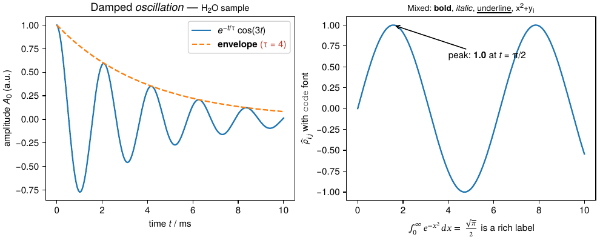
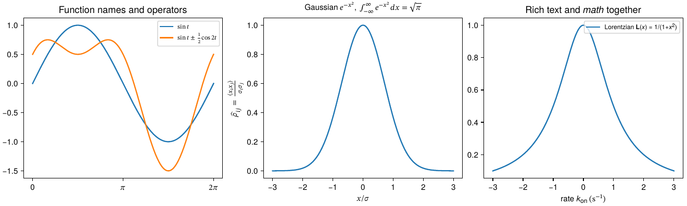

# umbruch-matplotlib

*Umbruch* (OOM-brookh) is German for page makeup, and also for upheaval.

A Matplotlib backend that draws figures as SVG and renders them to PDF with
[umbruch](https://github.com/manuel-rhdt/umbruch). Text and math are laid out by umbruch:
labels may contain rich text (`rich("<i>t</i><sub>0</sub>")`) and `$...$` math is converted to
MathML. The umbruch executable comes with the `umbruch` package; `$UMBRUCH` or `PATH` override it.

```python
import matplotlib
matplotlib.use("module://umbruch_matplotlib")
import matplotlib.pyplot as plt
from umbruch_matplotlib import rich

fig, ax = plt.subplots()
ax.set_xlabel(rich("time <i>t</i> (ms)"))
ax.set_title(r"$\hat\rho_{ij}=\frac{a}{b}$")
fig.savefig("fig.pdf")
```

Install with `pip install .[math]` (the `math` extra pulls in `latex2mathml`).

Unsupported features raise instead of falling back to Matplotlib's own text rendering:
`text.usetex`, and TeX that cannot be converted to MathML.

Fonts are passed to umbruch exactly as Matplotlib names them; nothing is remapped. Umbruch bundles all four faces of TeX Gyre Heros, Cursor and Termes, but only the regular and bold faces of DejaVu Sans, so with Matplotlib's default family italic text is set upright. Other families, including ones installed on the system, are not visible to umbruch and are substituted with a warning. Set the family you want, for example `matplotlib.rcParams["font.family"] = "TeX Gyre Heros"`.

Tick labels with exponents (`10^3`, `1×10^-4`) are set as text with superscripts in the label font, not as math. Math in `$...$` is converted to MathML and set in STIX Two Math. Gouraud triangles are subdivided until umbruch reports `mesh_gouraud`.

## Examples

Rich text through `rich()`: inline markup for italics, bold, sub- and superscripts, colour and size, in titles, labels, tick labels and annotations.



Math is laid out as MathML with STIX Two Math, with correct operator spacing and function application, and can be mixed with rich text.



A larger figure with hatching, gradients, colour bars, annotations, and math and rich text in titles, labels and legends. The output is a vector PDF whose text stays selectable.


The scripts are in `examples/`. `python examples/make_images.py` re-renders the PNGs (needs `pdftoppm` and an `umbruch` binary on `$UMBRUCH` or the path).

Tests: `pytest tests` (the ones that need the engine use the `umbruch` package, `$UMBRUCH` or the path, and are skipped without it).

## License

MIT, see `LICENSE`.
